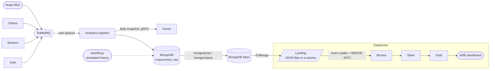

# Analytics platform

The services' databases serve the application. Some keep history (`sensors_db` has every reading and alert), others
only the current state: an order holds only its latest status, and a price is updated in place. The data is also
split per service, and analytical queries would compete with the application. The full history the business would
want to analyse (how a farm's humidity evolved, how long orders wait in each state, how sales react to a drought) is
in the messages that cross RabbitMQ, and it was lost once they were consumed. The analytics platform keeps it, apart
from the operational databases.



## Raw zone (MongoDB)

[Analytics.Ingestor](../Services/Analytics.Ingestor) has its own queues on the two exchanges, so it gets a copy of
every reading and domain event without changing the services that already consume them. It stores each one as it
arrived in MongoDB (database `cropconnect_raw`), and once a day it also stores a snapshot of the public catalog read
from Farms. The collections are described in the [data model](data-model.md#analyticsingestor-mongodb-cropconnect_raw).

Why a document database for this zone:

- **The payloads differ.** Each of the routing keys has its own fields, and new events or fields appear over time.
  A document keeps each one as it came, with no table per event type and no migration when a field is added.
- **The readings are a time series.** They arrive all the time and are always read by sensor and time, which is what
  MongoDB's time-series collections are made for.
- **It keeps the analytics away from the operational databases.** The PostgreSQL databases keep serving the
  application, and the analytics never query them.

## Running it

Docker Compose and the Aspire AppHost start MongoDB (published on `127.0.0.1:27018`) and the ingestor with the rest
of the platform. To have months of data to analyse, write a simulated history (marked `"simulated": true`):

```bash
python -m pip install -r analytics/backfill/requirements.txt
```

```bash
python analytics/backfill/backfill.py --replace
```

By default it writes 6 months for 24 farms (about 725,000 readings, 76,000 events and 32,000 snapshot documents);
`--help` lists the options. `--replace` deletes the simulated documents first, and the same `--seed` gives the same
history. The Databricks platform was built on `--replace --months 3 --farms 12` (about 213,000 readings), which fits
the 512 MB of a free Atlas cluster.

The backfill writes to MongoDB directly, not through RabbitMQ and the ingestor: it writes months of past events, which
the ingestor would stamp with the time they arrived. Its documents have the same shape as the ingestor's, so the
lakehouse treats both alike, and `simulated` tells them apart in every layer.

## Lakehouse (Databricks)

The notebooks in [analytics/databricks](../analytics/databricks) build a medallion lakehouse of Delta tables in
Unity Catalog (catalog `cropconnect`, one schema per layer). Databricks runs in the cloud and cannot reach the local
MongoDB, so the raw zone is copied to a MongoDB Atlas cluster with `mongodump`/`mongorestore`, and the landing reads it
from there. The copy holds the simulated history and the real documents the ingestor had stored by then; for the
lakehouse to follow the platform live, the ingestor would write to a MongoDB that Databricks can reach.

| Notebook | Layer | Writes |
|---|---|---|
| [00_landing.py](../analytics/databricks/00_landing.py) | Landing | The new MongoDB documents as JSON files in the volume `landing.raw`, one folder per collection. |
| [01_bronze.py](../analytics/databricks/01_bronze.py) | Bronze | One table per collection, each document kept whole as Extended JSON. **Auto Loader + `MERGE INTO`.** |
| [02_silver.py](../analytics/databricks/02_silver.py) | Silver | Typed tables per business concept, invalid readings in quarantine. Readings **incremental**, the rest rebuilt. |
| [03_gold.py](../analytics/databricks/03_gold.py) | Gold | Aggregates for the dashboard and a star schema of the sales. Rebuilt on every run. |

A job runs the four in order (each task only after the previous one succeeds), and the AI/BI dashboard reads only
Gold.

### Incremental writes

- **Landing.** Auto Loader ingests files and the raw zone is a database, so the landing turns the new documents into
  files. It keeps a watermark per collection (`receivedAt` or `snapshotAt`) in `landing._extract_state`, asks MongoDB
  only for newer documents (`$gte`) and writes them as JSON lines, already in the shape of a Bronze row. The watermark
  moves only once a collection was read to the end. Documents are read unsorted: sorting a time-series collection by
  a field other than its time field goes over the 32 MB sort limit of a free Atlas cluster. The files are kept, so the
  landing is also an archive Bronze can be rebuilt from.
- **Bronze** reads the landing folders with **Auto Loader** (`cloudFiles`, with the schema given rather than
  inferred), which keeps the files it already processed in a checkpoint in the `landing.checkpoints` volume. It runs
  with `trigger(availableNow=True)`: every new file is processed and the stream stops, which is how a scheduled job
  uses it. Each micro-batch is written with **`MERGE INTO`** on the document id, so a document read twice (the
  landing reads the last millisecond again) is never duplicated. Each row records its `_source_file`.
- **Silver** does the same for the sensor readings, with the Bronze `_ingested_at` as the watermark
  (`silver._processing_state`) and a `MERGE INTO` on `reading_id`. The `full_refresh` widget rebuilds them, for
  example after a quality rule changes. The other Silver tables are small and rebuilt on every run.

### Dropped tables and files

| Dropped | What the next run does |
|---|---|
| A Bronze table | Its Auto Loader checkpoint is deleted too, so every landing file is read again. |
| A landing folder, or `landing._extract_state` | The collection is extracted again from MongoDB; Bronze's `MERGE INTO` skips what it has. |
| `silver.sensor_readings` or `silver.sensor_readings_rejected` | The watermark is ignored and every Bronze reading is processed again. |
| Any other Silver or Gold table | It is rebuilt. |

### Star schema

`gold.fact_order_lines` is the fact table, at the grain of an order line (quantity, unit price, line total, whether
the order was cancelled), with keys to `gold.dim_farm`, `gold.dim_product` and `gold.dim_date` (`date_key` as
`yyyyMMdd`). The notebook checks that every fact finds its farm, product and day. `gold.order_lifecycle` is a fact
table too, an accumulating snapshot with one date column per step of the order.

### Running it in Databricks

1. Import the four notebooks into the workspace.
2. Store the Atlas connection string as the secret `cropconnect`/`mongo-uri` (or fill the `mongo_uri` widget of
   `00_landing` for a one-off run). It never goes into the code.
3. Create a job with the four notebooks as dependent tasks (landing, bronze, silver, gold), on serverless compute.
   The landing creates the `landing` schema and its two volumes on its first run.
