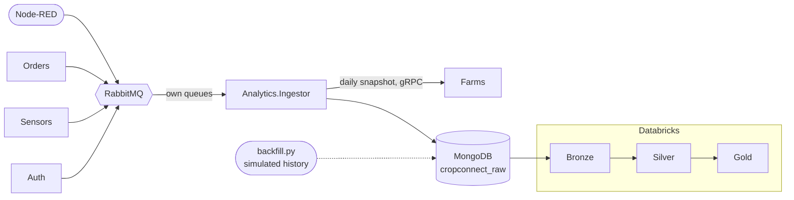

# Analytics platform

The services keep only the current state: a reading is checked against the thresholds and kept in `sensors_db`, an
order holds only its latest status. The history the business would want to analyse (how a farm's humidity evolved,
how long orders wait in each state, how sales react to a drought) is in the messages that cross RabbitMQ, and it was
lost once they were consumed. The analytics platform keeps it.



## Raw zone (MongoDB)

[Analytics.Ingestor](../Services/Analytics.Ingestor) has its own queues on the two exchanges, so it gets a copy of
every reading and domain event without changing the services that already consume them. It stores each one as it
arrived in MongoDB (database `cropconnect_raw`), and once a day it also stores a snapshot of the public catalog read
from Farms. The collections are described in the [data model](data-model.md#analyticsingestor-mongodb-cropconnect_raw).

Why a document database for this zone:

- **The payloads differ.** Each of the routing keys has its own fields, and new events or fields appear over time.
  A document keeps each one as it came, with no table per event type and no migration when a field is added.
- **The readings are a time series.** They arrive all the time and are always read by sensor and time, which is what
  MongoDB's time-series collections are made for.
- **It keeps the analytics away from the operational databases.** The PostgreSQL databases keep serving the
  application, and the analytics never query them.

## Running it

Docker Compose and the Aspire AppHost start MongoDB (published on `127.0.0.1:27018`) and the ingestor with the rest
of the platform. To have months of data to analyse, write a simulated history (marked `"simulated": true`):

```bash
python -m pip install -r analytics/backfill/requirements.txt
```

```bash
python analytics/backfill/backfill.py --replace
```

By default it writes 6 months for 24 farms (about 725,000 readings, 76,000 events and 32,000 snapshot documents);
`--help` lists the options. `--replace` deletes the simulated documents first, and the same `--seed` gives the same
history.
