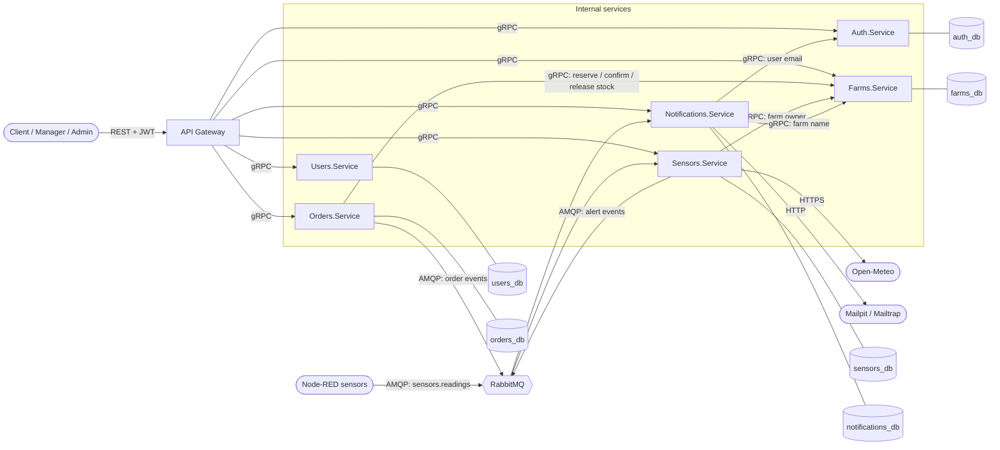
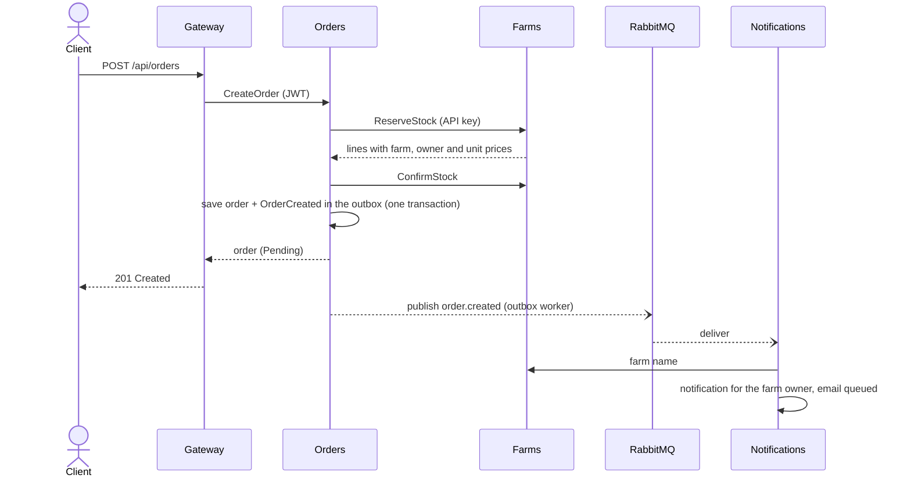

# Architecture

CropConnect is a set of .NET 10 microservices. Clients only talk REST to the API gateway; the services talk gRPC to
each other and exchange events through RabbitMQ. Each service owns its PostgreSQL database (section 5.1 of the report).

## Services

| Service | Responsibility | Requirements |
|---|---|---|
| Auth.Service | Registration, login, JWT issue and validation, user accounts and roles | RF01-RF03 |
| Users.Service | Personal profile of each account | RF01 |
| Farms.Service | Farms, pickup schedules, products and seasonal baskets, stock and its reservations | RF04-RF09, RF11 |
| Orders.Service | Order life cycle and reviews; orchestrates the stock reservation | RF10-RF15 |
| Sensors.Service | Readings, global thresholds, alerts with the rain forecast | RF04, RF16-RF18 |
| Notifications.Service | Turns events into in-app notifications and emails | RF19-RF21 |
| API Gateway | The only REST entry point: JWT validation, routing to gRPC, OpenAPI | RNF04 |

## Communication

- **North-south (REST).** The gateway validates the JWT, checks with Auth that the account is still active (cached
  for 15 s), and forwards the call to the owning service over gRPC with the caller's token and a 15 s deadline. gRPC
  status codes come back as HTTP problem details (see the [REST API](api.md)).
- **East-west (gRPC).** Calls a user makes are authorized by each service from the forwarded JWT (roles in the `role`
  claim). Calls between services (stock reservation, farm and user lookups) use a shared internal API key in the
  `x-api-key` header instead, and those RPCs accept nothing else.
- **Events (RabbitMQ).** Order and alert events go to the `cropconnect.events` topic exchange; Node-RED publishes
  readings to `sensors.readings`. See [Messaging](messaging.md).

## Main flows

### Placing an order (RF10, RF11, RF19)

If anything fails after the reservation, Orders releases the stock before answering (compensation). A reservation
that is never confirmed expires after 15 minutes and Farms returns its stock.

### Cancelling (RF14, RF20)

Orders saves the cancellation and the `OrderCancelled` event together, then asks Farms to release the stock. If Farms
is down the cancellation still succeeds; a background worker retries the release until it goes through.

### Sensor reading (RF16, RF17, RF21)

Node-RED publishes a reading → Sensors checks the farm is active, stores the reading and compares it with the global
threshold → if it is out of range (and no alert of that type was raised for the farm in the last 30 minutes) it
raises an alert, adds the rain forecast for low humidity, and saves reading, alert and `SensorAlertRaised` event in
one transaction → Notifications tells the farm owner.

## Reliability (RNF03)

| Mechanism | Where | What it guarantees |
|---|---|---|
| Transactional outbox | Orders, Sensors | An event is saved with the change that caused it and published later, at least once; a broker outage loses nothing |
| Mandatory publishing | Orders, Sensors | An event no queue can receive yet stays in the outbox instead of being dropped |
| Idempotent consumers | Sensors (`MessageId`), Notifications (`SourceEventId` + recipient) | A redelivered message has no second effect |
| Retries, then dead-letter | Sensors, Notifications | Invalid messages go straight to a dead-letter queue; other failures are retried up to 60 times (about 5 min) |
| Email retries with backoff | Notifications | Emails survive a mail server outage (30 s, 1 min, 2 min... up to 5 attempts) |
| Stock compensation and expiry | Orders, Farms | A failed order creation never keeps stock reserved |
| Deadlines and HTTP retries | Gateway, service clients | A hung service cannot hold a request; idempotent calls are retried, unsafe ones are not |
| Optimistic concurrency | Farms, Orders, Sensors (`Version`) | Two concurrent edits of the same entity cannot silently overwrite each other |

The resilience end-to-end tests check two of these: orders are still created while Notifications is down, and
emails go out once the mail server is back.

## Observability (RNF05)

Every service uses `CropConnect.ServiceDefaults`: OpenTelemetry logs, metrics and traces (ASP.NET Core, gRPC,
HttpClient, Npgsql, RabbitMQ), and `/health` and `/alive` endpoints. The W3C trace context of a request is stored in
the outbox and in each notification, so one trace follows an order from the gateway through RabbitMQ to the email.
Under Aspire and in Docker Compose the telemetry goes to the Aspire dashboard.

## Deployment (RNF06)

Every service has a multi-stage Dockerfile and runs as a non-root user. `compose.yaml` starts the whole system
(only the gateway is published beyond `127.0.0.1`), and the Aspire AppHost runs it for development. GitHub Actions
builds the solution, runs the unit tests and then the end-to-end tests against Compose on every pull request.
