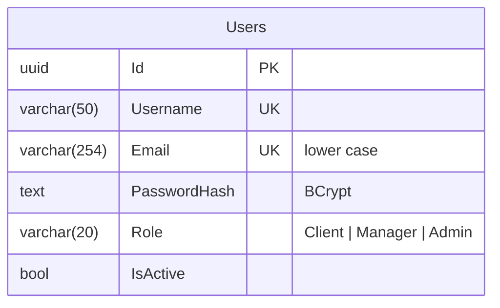
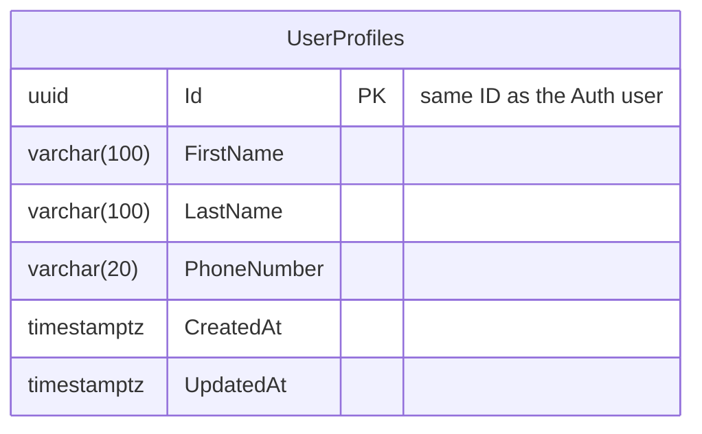
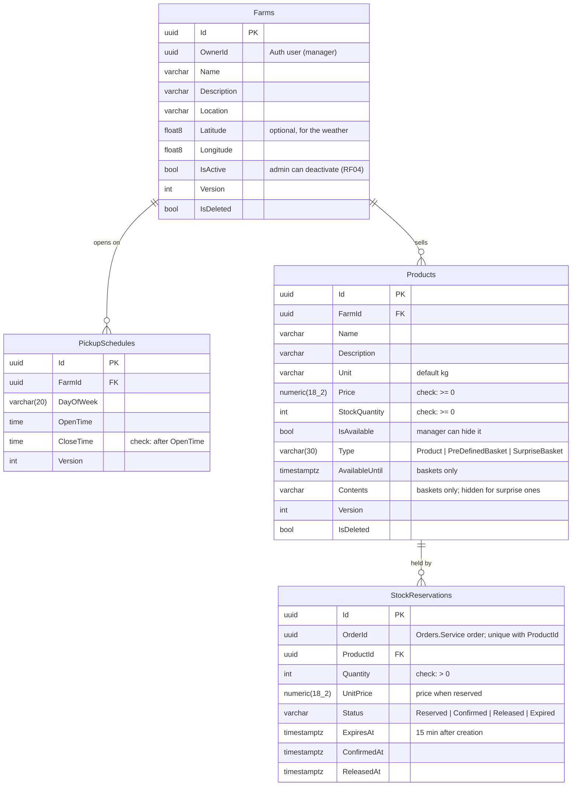
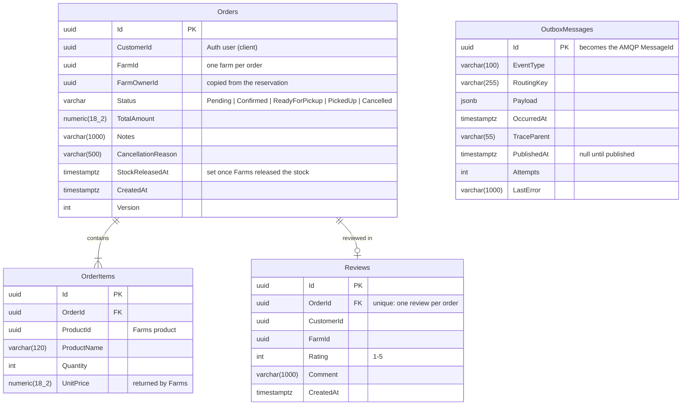
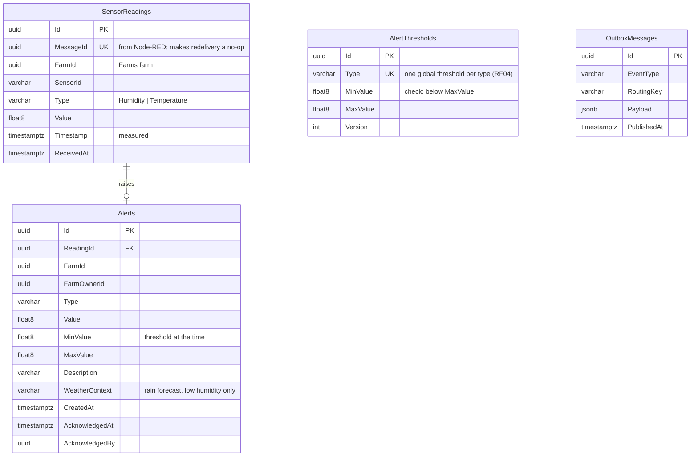
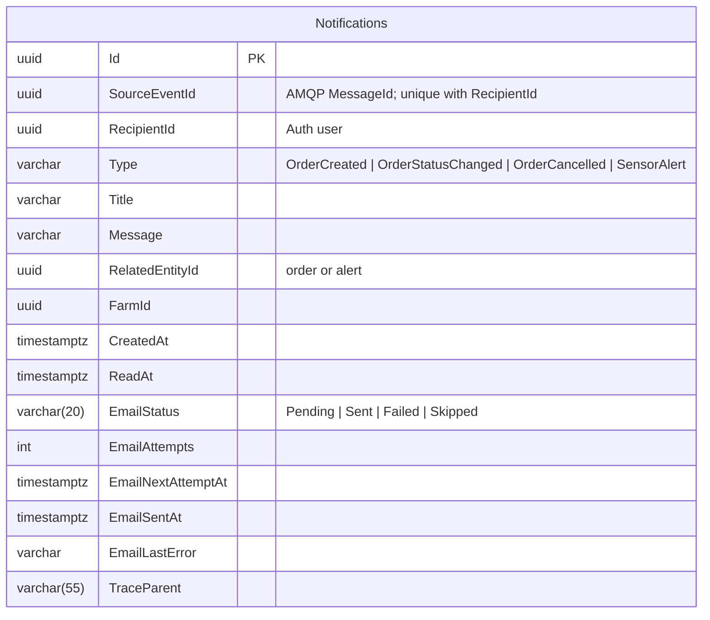

# Data model

Each service owns one PostgreSQL database and no service reads another's. References across services (a farm's
`OwnerId`, an order's `ProductId`) are plain IDs, checked through gRPC rather than foreign keys. The schemas are
created by each service's EF Core migrations.

Common columns: entities that users edit carry a `Version` used for optimistic concurrency and soft-delete with
`IsDeleted`; times are UTC.

## Auth.Service (`auth_db`)

The administrator account is created on startup from the `BootstrapAdmin` settings; nobody can register as one.

## Users.Service (`users_db`)

## Farms.Service (`farms_db`)

Seasonal baskets are products with a basket `Type` (section 2.6). A product is in the catalog while it is available,
its farm is active and, for a basket, `AvailableUntil` has not passed; an expired basket is final.

## Orders.Service (`orders_db`)

## Sensors.Service (`sensors_db`)

The thresholds are seeded by the migration (humidity 30-80 %, temperature 5-35 °C); the administrator only changes
them. Readings are indexed by farm, type and time for the history queries (RF18).

## Notifications.Service (`notifications_db`)

Each notification is listed in the app and sent by email in the background; `EmailNextAttemptAt` drives the retries.
