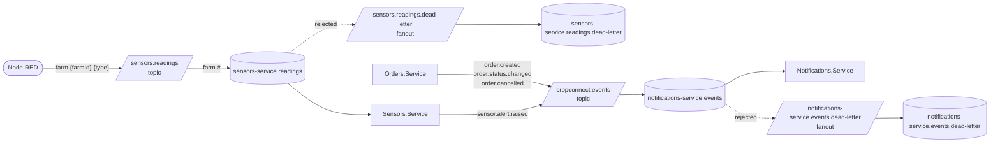

# Messaging

RabbitMQ carries the two asynchronous flows of section 5.4: business events (Orders → Notifications) and IoT
(Node-RED → Sensors → Notifications). Every exchange and queue is durable, every message persistent, and each service
declares what it uses on startup, so the start order does not matter.



## Exchanges and queues

| Name | Kind | Declared by | Bindings / notes |
|---|---|---|---|
| `sensors.readings` | topic exchange | Sensors, Node-RED | Readings from the simulated sensors |
| `sensors-service.readings` | queue | Sensors | Bound with `farm.#`; dead-letters to `sensors.readings.dead-letter` |
| `sensors.readings.dead-letter` | fanout exchange | Sensors | → `sensors-service.readings.dead-letter` |
| `cropconnect.events` | topic exchange | Orders, Sensors, Notifications | Domain events |
| `notifications-service.events` | queue | Notifications | Bound with the four routing keys below; dead-letters to `notifications-service.events.dead-letter` |
| `notifications-service.events.dead-letter` | fanout exchange | Notifications | → queue of the same name |

## Messages

All bodies are JSON (`application/json`), camelCase, with enums as camelCase strings and times in UTC (ISO 8601).

### Sensor reading (Node-RED → Sensors, RF16)

Exchange `sensors.readings`, routing key `farm.{farmId}.{type}`.

```json
{
  "messageId": "6f1c0e2a-8f0e-4a43-9a8e-3b1d2c4e5f60",
  "farmId": "4eb12325-6e2c-452d-b9d1-20d532c1bbfd",
  "sensorId": "sim-4eb12325",
  "type": "humidity",
  "value": 27.4,
  "timestamp": "2026-10-30T10:00:00Z"
}
```

`type` is `humidity` (0-100 %) or `temperature` (-50 to 70 °C). `messageId` makes a redelivered reading a no-op.

### Domain events (`cropconnect.events`)

Published from the outbox of their service. The AMQP `MessageId` is the outbox message ID and `Type` the event name;
the W3C `traceparent` header carries the trace of the request that caused the event.

| Routing key | Event | Producer | Who is notified |
|---|---|---|---|
| `order.created` | `OrderCreated` | Orders | Farm owner (RF19) |
| `order.status.changed` | `OrderStatusChanged` | Orders | Customer, unless the order went back to Pending (RF20) |
| `order.cancelled` | `OrderCancelled` | Orders | The other party: the farm owner if the customer cancelled, otherwise the customer (RF20) |
| `sensor.alert.raised` | `SensorAlertRaised` | Sensors | Farm owner (RF21) |

```json
// order.created
{ "orderId": "…", "customerId": "…", "farmId": "…", "farmOwnerId": "…",
  "totalAmount": 12.5, "itemCount": 2, "occurredAt": "2026-10-30T10:00:00Z" }

// order.status.changed (status: pending | confirmed | readyForPickup | pickedUp | cancelled)
{ "orderId": "…", "customerId": "…", "farmId": "…", "farmOwnerId": "…",
  "previousStatus": "confirmed", "newStatus": "readyForPickup", "occurredAt": "…" }

// order.cancelled
{ "orderId": "…", "customerId": "…", "farmId": "…", "farmOwnerId": "…",
  "previousStatus": "pending", "reason": "Changed my mind", "cancelledByCustomer": true, "occurredAt": "…" }

// sensor.alert.raised
{ "alertId": "…", "farmId": "…", "farmOwnerId": "…", "farmName": "Quinta do Vale",
  "type": "humidity", "value": 18.4, "minValue": 30, "maxValue": 80, "unit": "%",
  "description": "Humidity of 18.4% from sensor s-01 is below the minimum of 30%.",
  "weatherContext": "No significant rain forecast in the next 24h (0.2 mm, up to 10% chance); consider irrigating.",
  "occurredAt": "…" }
```

Each order transition of the state model (section 4.2) produces exactly one event: entering Pending is
`order.created`, Confirmed / ReadyForPickup / PickedUp are `order.status.changed`, and Cancelled is `order.cancelled`.

## Delivery guarantees

- **Producers** save the event in the same transaction as the change (outbox) and publish it with publisher
  confirms and `mandatory` set, so an event is never lost: if the broker is down, or no queue is bound yet, it stays
  in the outbox (`LastError` says why) and is retried every 2 seconds, in order.
- **Consumers** acknowledge manually, at least once. They are idempotent: Sensors by the reading's `messageId`,
  Notifications by the event's `MessageId` together with the recipient.
- **Invalid messages** (bad JSON, unknown farm, inactive farm, unsupported routing key) are rejected straight to
  the dead-letter queue.
- **Other failures** (a database or a dependency down) are retried: the message is republished to the back of its
  queue with an `x-retry-count` header (and its original routing key in `x-original-routing-key`) and dead-lettered
  after `RabbitMq:MaxRetries` attempts (60 by default, about 5 minutes).
